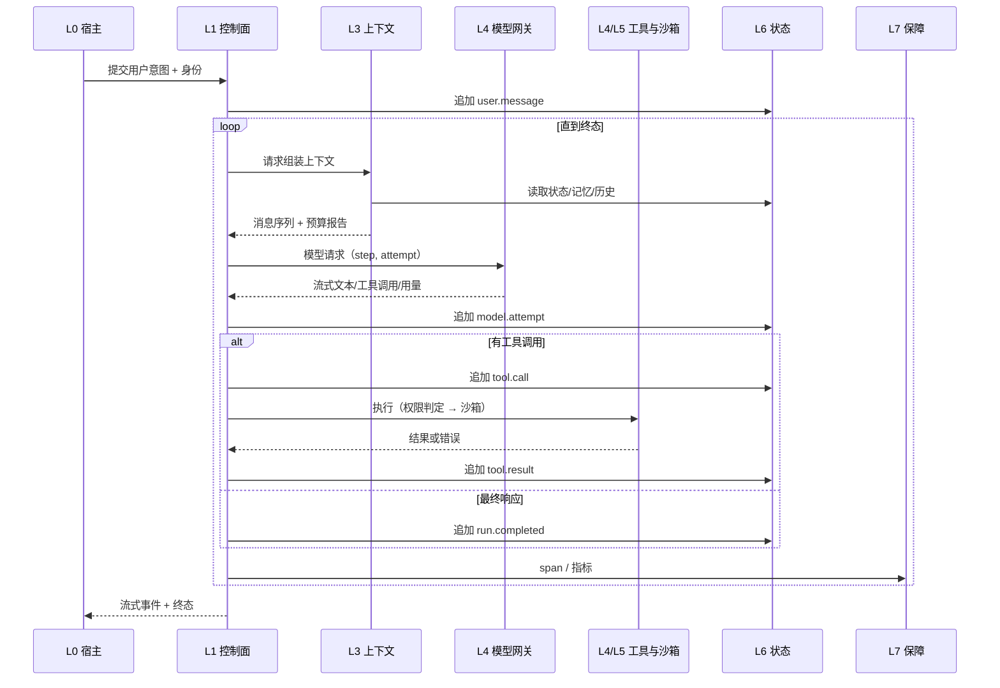

# 01. 参考架构：八层、六契约、十二不变量

> 所属：Agent Harness 建设蓝图 / 第一部分 方法论
> 版本：v1.0-draft（2026-10-18）
> 性质：厂商中立的参考架构。它描述“一个可持续演进的 Agent 系统应该由什么组成”，不描述任何具体实现。

## 1. 设计目标

参考架构要同时满足四个目标，它们彼此冲突，必须显式取舍：

| 目标 | 含义 | 常见代价 |
|---|---|---|
| 可恢复 | 崩溃、重启、审批等待后能继续，且不重复副作用 | 状态模型复杂、写入放大 |
| 可替换 | 模型、工具、沙箱、前端、存储可独立替换 | 需要稳定契约与适配层 |
| 可约束 | 危险动作在执行前被阻止，权限最小化 | 交互变慢、需要审批 UX |
| 可度量 | 每个决策与失败都能被观察与评估 | 埋点成本、隐私处理 |

一个只追求“能跑”的系统通常牺牲后三项；一个只追求“安全”的系统通常不可用。参考架构的作用是让取舍可见。

## 2. 八层模型（L0-L7）

```
L0 宿主与表面      CLI / TUI / Desktop / Web / SDK 调用方
L1 控制面          循环、规划、编排、停止条件、HITL
L2 契约面          身份、消息、工具、事件、状态、策略
L3 上下文面        预算、组装、压缩、卸载、隔离
L4 能力面          模型网关、工具、技能、记忆
L5 执行面          沙箱、进程、网络、文件、产物
L6 状态面          日志、归约、检查点、恢复、会话存储
L7 保障面          追踪、指标、评测、成本、审计
```

### 2.1 各层职责与失败模式

| 层 | 职责 | 输入 | 输出 | 典型失败 |
|---|---|---|---|---|
| L0 宿主 | 收集意图、渲染过程、管理生命周期与配置 | 用户输入、配置 | 运行请求、取消信号 | 把业务逻辑写进 UI；配置与运行时不一致 |
| L1 控制面 | 决定下一步做什么，何时停止 | 上下文、模型输出、策略结果 | 模型请求、工具请求、终态 | 无界循环、停止条件只看步数、取消不传播 |
| L2 契约面 | 定义跨层数据结构与版本 | 各层需求 | 稳定类型与协议 | 双份契约漂移、字段语义模糊、版本不兼容 |
| L3 上下文面 | 在预算内构造高信号上下文 | 状态、记忆、工具结果 | 消息序列 | 上下文腐烂、压缩丢关键决策、缓存失效 |
| L4 能力面 | 提供模型、工具、技能、记忆能力 | 请求 | 结果与用量 | 供应商方言泄漏、工具结果无界、记忆污染 |
| L5 执行面 | 安全地执行副作用 | 工具请求 | 观察结果、产物 | 沙箱逃逸、凭证泄漏、命令挂起 |
| L6 状态面 | 持久化事实并支持恢复 | 事件 | 状态、检查点 | 日志与状态不一致、恢复重复执行、旧持有者写入 |
| L7 保障面 | 让系统可观察、可评估、可计费 | 事件、span、样本 | 指标、报告、告警 | 只有日志没有指标、评测与生产脱节 |

### 2.2 层间依赖规则

1. 依赖只能向下，不能向上。L3 不能直接调用 L0 的 UI。
2. 同层组件通过契约通信，不共享可变对象。
3. 跨层调用必须经过接口，不允许“为了快”直接读对方内部结构。
4. L6 是唯一可以被称为“事实源”的层；其他层都是派生或缓存。
5. L7 只读，不得改变执行路径（除非通过显式的策略反馈回路）。

## 3. 控制面与数据面

把八层按另一种维度切分，可以得到更清晰的运维边界：

| 面 | 包含 | 特征 | 伸缩方式 |
|---|---|---|---|
| 控制面 | L1 控制、L2 契约、L3 上下文、L4 模型与工具选择 | 无状态或弱状态，CPU/网络密集 | 水平扩展，按请求 |
| 数据面 | L5 执行、L6 状态、L4 记忆存储 | 有状态，IO 密集，需隔离 | 按会话/租户分片 |
| 保障面 | L7 | 旁路，异步 | 采样与批处理 |

Anthropic 的 Managed Agents 把这一区分推到极致：brain（模型 + harness）与 hands（沙箱与工具）分离，session 独立存放。结果是 harness 可以随时重启，容器失败被当作工具错误返回给模型 [C: Anthropic, 2026-04]。

本文判断：控制面/数据面分离不是大规模系统才需要。只要存在“执行环境可能挂掉”或“审批可能等待数小时”，分离就能显著降低恢复复杂度。

## 4. 六个核心契约

契约是参考架构的骨架。任何 Agent 系统，无论用什么框架，都必须回答这六个问题。

### C1 身份契约（Identity）

必须能唯一标识：

```
conversation > task > run > thread > turn > attempt > call > transaction > artifact > checkpoint
```

要求：

- 每层 ID 不可复用，跨进程可比较；
- 子线程、子代理、后台任务都能追溯到父 run；
- 检查点、日志、产物、追踪使用同一套身份；
- 恢复时校验身份，防止把 A 会话的状态灌进 B 会话。

### C2 消息契约（Message）

模型输入输出必须有稳定的内部表示：

- 保留 provider 原生块（文本、工具调用、工具结果、思考、图像），不要过早压平成字符串；
- 工具调用与结果必须成对，且顺序稳定；
- 角色、缓存标记、可见性（是否进入上下文）是显式字段；
- 版本化，升级时提供迁移而非静默解释。

### C3 工具契约（Tool）

一个工具必须同时定义：

| 维度 | 必须明确 |
|---|---|
| 标识 | 命名空间 + 名称，跨 MCP 与内置工具不冲突 |
| 输入 | JSON Schema，严格校验，未知字段拒绝 |
| 输出 | 成功结构、错误结构、输出上限、截断策略 |
| 副作用 | 只读/可逆/不可逆，是否可并行 |
| 权限 | 所需能力、是否需要审批、审批粒度 |
| 生命周期 | 超时、取消、重试语义、幂等键 |
| 可观测 | 关键参数脱敏后的追踪字段 |

缺少任一项，工具在长任务中都会变成不可控点。

### C4 事件契约（Event）

- 追加写，不可修改；
- 单写者或带 fencing 的多写者；
- 每个事件有单调序号、类型、时间、因果父、payload 版本；
- 事件类型是封闭集合，扩展需版本化；
- 大负载走内容寻址存储，事件只留引用。

### C5 状态契约（State）

- 状态由事件确定性归约得到；
- 归约有版本号，升级需要迁移或双读；
- 投影是只读派生，不得反向写回；
- 恢复时先归约、再对账、再继续；
- 任何“当前值”都必须能从事件重新算出。

### C6 策略契约（Policy）

- 判定结果是三态：允许、询问、拒绝，外加“需要修改后重试”；
- 判定输入是结构化动作，不是自然语言；
- 审批绑定动作指纹（工具名 + 规范化参数 + 目标资源 + 会话）；
- 拒绝必须可解释，且不泄露敏感策略细节；
- 策略求值顺序固定，短路规则明确。

## 5. 十二条不变量

不变量是“无论怎么重构都不能破”的性质。建议把它们写进架构基线与测试。

| 编号 | 不变量 | 违反后果 |
|---|---|---|
| I1 | 每个工具调用最终有且只有一个终态（成功/失败/不确定/取消） | 恢复时无法判断是否重复执行 |
| I2 | 已完成且不可逆的副作用不因恢复而重复 | 重复转账、重复发消息、重复部署 |
| I3 | 事实只来自日志，状态只来自归约 | 多事实源漂移，排障无依据 |
| I4 | 投影不参与决策写入 | 隐式状态导致不可重放 |
| I5 | 取消沿调用树向下传播，且可中断等待 | 用户已停止但仍在计费或改文件 |
| I6 | 权限判定发生在副作用之前 | 事后审计无法阻止损害 |
| I7 | 凭证不进入模型上下文与沙箱文件系统 | 提示注入可直接窃取 |
| I8 | 上下文超限时优先卸载与修剪，不静默丢弃 | 关键决策与未解决 bug 丢失 |
| I9 | 模型调用可归因到 run/step/attempt，用量可计量 | 成本不可解释，无法优化 |
| I10 | 子代理只返回蒸馏结果，不回传完整轨迹 | 主上下文被噪声淹没 |
| I11 | 协议边界不引入第二事实源 | 平台锁定与状态分裂 |
| I12 | 所有外部输入（工具结果、网页、文件）默认不可信 | 间接提示注入 |

## 6. 端到端数据流



关键点：模型从不直接写状态，工具从不直接改日志，宿主从不直接读数据库。所有写入经过契约。

## 7. 三种部署拓扑

### 7.1 单体拓扑

进程内完成循环、工具、状态。适合本地 CLI、单用户、可信工具。

- 优点：延迟低、调试简单。
- 风险：执行失败即会话失败；沙箱与凭证同处一地。

### 7.2 脑手分离拓扑

harness 独立于沙箱，沙箱通过 `execute(name, input) -> string` 调用，session 独立存储。

- 优点：harness 可无状态重启，沙箱可替换，TTFT 更稳定。
- 代价：需要定义远程执行契约、超时、重连、事件回放。
- 证据：Anthropic 报告 p50 TTFT 下降约 60%，p95 下降超过 90% [C: 2026-04]。

### 7.3 托管平台拓扑

云平台提供 runtime、session、memory、identity、gateway，开发者只写 agent 逻辑。

- 优点：运维外包，集成齐全。
- 风险：状态与身份被平台绑定；迁移需要抽象层；配额与区域限制。
- 证据：AWS AgentCore 提供 Runtime/Memory/Gateway/Identity/Code Interpreter/Browser/Observability 七件套 [A: AWS, 2025-07]；Azure 与 Vertex 提供会话与记忆托管 [A/D: 厂商文档与对比报道]。

## 8. 五组设计张力

| 张力 | 一侧 | 另一侧 | 建议 |
|---|---|---|---|
| 自主性 vs 可控性 | 少打断、连续执行 | 每步审批、严格策略 | 按副作用分级，不可逆动作才打断 |
| 上下文完整性 vs 成本 | 保留全部历史 | 只留高信号 | 卸载优先，压缩保决策与未解问题 |
| 通用性 vs 专用性 | 一个大 Agent 处理所有任务 | 多个专用 Agent | 先单 Agent + 技能，确有并行收益再拆分 |
| 框架便利 vs 契约稳定 | 直接用框架对象 | 自有 canonical 类型 | 边界处转换，内部保留自有类型 |
| 平台集成 vs 可迁移 | 用满托管能力 | 自建抽象层 | 状态与身份必须可导出 |

## 9. 反模式清单

以下模式在事故复盘中反复出现：

1. **消息数组即状态**：进程重启后无法恢复工具事务。
2. **工具调用无终态**：崩溃后不知道命令是否执行。
3. **审批基于自然语言**：用户批准的是“帮我清理一下”，执行的是删除。
4. **上下文压缩无摘要**：中间段被丢弃，模型失去任务目标。
5. **重试不判断响应是否已开始**：重复生成、重复扣费。
6. **子代理回传完整轨迹**：主上下文被 10 倍噪声填满。
7. **凭证与代码同容器**：一次提示注入即可外带。
8. **日志与展示共用一份数据**：为了 UI 分页修改了事实记录。
9. **能力表是装饰**：声明支持视觉/推理，运行时从不消费。
10. **评测只测最终答案**：路径错误但答案碰巧正确，回归无法发现。

## 10. 本层在 FloodMind 对照中的用法

后续 `13-floodmind-gap-analysis.md` 会按 L0-L7 与 C1-C6 逐项打分。打分依据只有两类证据：

- 代码与测试中的可验证事实（以 `docs/knowledge-graph/` 的 `file:line` 为准）；
- 目标架构基线中的显式声明（`docs/architecture/FM_ARCHITECTURE_BASELINE.md`）。

不使用“业界都这么做”作为扣分理由；业界做法只用于判断某项能力是否被遗漏。
