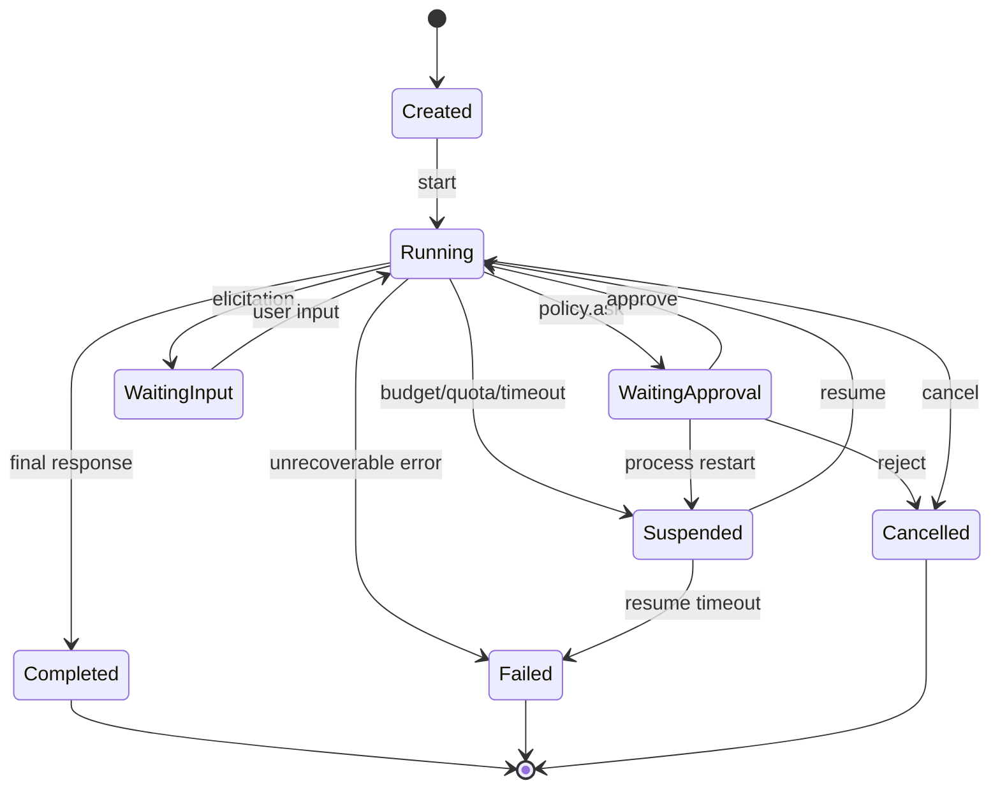

# 02. 控制循环与持久化执行

> 所属：Agent Harness 建设蓝图 / 第二部分 横向能力
> 版本：v1.0-draft（2026-10-18）
> 核心问题：如何让一个会失败、会等待、会被中断的循环，仍然只在正确的事情上产生副作用。

## 1. 循环的规范形状

一个可恢复的 Agent 循环不是 `while True: call_model()`，而是六个阶段的状态推进：

```
1. 装载      从持久层取状态，校验身份与版本
2. 组装      在预算内构造上下文（见 03）
3. 推理      调用模型，流式收集，记录 attempt
4. 解释      解析文本/工具调用/停止原因，做合法性检查
5. 执行      权限判定 → 工具事务 → 结果归一（见 04/05）
6. 提交      追加事件，推进状态，判断是否终态
```

每个阶段都必须满足两个条件：

- **可重入**：同一阶段重复执行不会产生额外副作用。
- **可中断**：在任意边界收到取消，都能在有限时间内停下并留下终态。

Claude Agent SDK 在循环层暴露 `max_turns` 与 `max_budget_usd` 作为硬停止条件，并把工具执行策略规定为“只读工具可并行、修改型工具串行” [A: Claude Agent SDK, Agent Loop]。OpenAI Agents SDK 则把 `max_turns` 设为 `Runner.run()` 的内建上限，并定义 `MaxTurnsExceeded` 等具名错误 [A: OpenAI Agents SDK, Running Agents]。

## 2. 运行状态机

推荐的最小状态机：



要求：

- 状态迁移只能由事件驱动，不能由内存标志驱动；
- 每个非终态都必须有“重启后如何判定”的规则；
- `Suspended` 不是失败，恢复时必须能区分“等待人类”与“进程死了”。

## 3. 停止条件

只靠“模型说完了”是不够的。完整的停止条件集合：

| 类型 | 触发 | 处理 | 是否可恢复 |
|---|---|---|---|
| 正常完成 | 模型返回最终文本/结构化结果 | 追加 completed | 终态 |
| 最大步数 | 达到 turn/step 上限 | 追加 failed(reason=max_steps) | 可人工续跑 |
| 预算耗尽 | token/金额/时长超限 | 暂停或失败，视策略 | 可追加预算后恢复 |
| 策略拒绝 | 权限判定 deny | 把拒绝作为工具结果回填，允许模型改方案 | 否，但 run 可继续 |
| 取消 | 用户或上游 abort | 传播到所有子任务与工具 | 终态 |
| 不可恢复错误 | 契约破坏、状态不一致 | 失败并保留现场 | 需人工 |
| 无进展 | 连续 N 步无新信息 | 停止并报告 | 可人工 |
| 外部等待 | 审批、异步任务 | 挂起，释放执行资源 | 是 |

“无进展检测”常被忽略。建议至少检测：连续重复相同工具调用、工具错误率持续为 100%、上下文字符数不再增长。

预算执行有一个容易忽略的细节：Claude Agent SDK 的 `max_budget_usd` 是在模型响应返回后按实际用量比较的，因此最终花费可能超出上限“一个响应的成本”，子代理在停止前也可能继续消耗 [A: Claude Agent SDK, Turns and budget]。设计预算时要么预留余量，要么在执行前做预估拦截。子代理的花费应计入父级总预算，否则预算会被并行分支绕过。

## 4. 事件模型

### 4.1 事件分类

建议按“谁产生、是否可重放、是否影响状态”三个维度分类：

| 类别 | 示例 | 进入 reducer | 说明 |
|---|---|---|---|
| 输入事件 | user.message, approval.decision | 是 | 外部输入，必须持久化 |
| 推理事件 | model.attempt.started/completed | 是 | 记录用量、结束原因 |
| 工具事件 | tool.call, tool.result, tool.error | 是 | 必须成对 |
| 生命周期事件 | run.started, run.completed, resume.started | 是 | 用于恢复与审计 |
| 派生事件 | summary.created, memory.consolidated | 视情况 | 可能只写旁路存储 |
| 观测事件 | span, metric | 否 | 走 L7，不进主日志 |

### 4.2 事件字段

最小字段集：

```
event_id        全局唯一
sequence        单调递增（单写者）或带 fencing 的逻辑序号
type            封闭枚举，带版本
occurred_at     产生时间（不是写入时间）
recorded_at     写入时间
run_id / thread_id
causation_id    直接原因事件
correlation_id  跨线程关联
payload_schema  版本
payload         小负载内联，大负载引用
```

`occurred_at` 与 `recorded_at` 分离很重要：重放时排序依据是 sequence，不是墙上时间。

### 4.3 写入保证

| 级别 | 保证 | 代价 | 适用 |
|---|---|---|---|
| 至少一次 | 崩溃可能重复 | 低 | 可去重的事件 |
| 恰好一次（逻辑） | 序号 + 幂等键去重 | 中 | 工具结果、审批 |
| 事务写 | 事件与业务数据同事务 | 高 | 与外部数据库强一致 |

LangGraph 提供 `exit` / `async` / `sync` 三档持久化模式，分别对应“只在结束/中断时写”“下一步执行时异步写”“下一步前同步写” [A: LangGraph Durable Execution]。这是很好的分级范例：默认不应是最高档，但必须能升到最高档。

## 5. 归约与投影

### 5.1 归约器要求

- 纯函数：`(state, event) -> state`，不读时钟、不读网络、不读随机数。
- 确定性：同一事件序列在任何机器上得到同一状态。
- 版本化：`reducer_version` 写入检查点；升级需迁移或双读。
- 幂等：重复消费同一 sequence 不改变结果。
- 可校验：未知事件类型必须报错，不能静默跳过。

### 5.2 投影

投影用于 UI、提示词历史、统计。规则：

- 投影可以被丢弃并重建；
- 投影不写回日志；
- 投影可以缓存，但缓存键必须含 reducer 版本与游标；
- 展示层字段（分页、折叠、主题）不应进入权威事件。

FloodMind 的现有设计符合这一模式：Journal 为权威，reducer 派生 `RunState.turns`，`DualMemory` 再做历史投影 [B: `docs/knowledge-graph/04-runtime-kernel.md`, `05-memory.md`]。

## 6. 工具事务

工具是副作用的主要来源，必须有显式事务语义。

### 6.1 推荐顺序

```
1. 生成调用 ID 与幂等键
2. 追加 tool.call（intent），状态 pending
3. 权限判定（allow / ask / deny）
4. ask：追加 approval.requested，挂起
5. 执行前再次校验（防止审批期间参数被替换）
6. 在沙箱中执行，带超时与取消
7. 归一结果（成功/失败/不确定/取消）
8. 追加 tool.result，状态 committed
```

第 5 步是很多实现遗漏的地方：审批的是“动作指纹”，执行前必须确认实际参数与指纹一致。

### 6.2 失败矩阵

| 崩溃时点 | 恢复后判定 | 处理 |
|---|---|---|
| tool.call 之前 | 未发生 | 重新决策 |
| tool.call 之后、执行之前 | 意图存在，无结果 | 可安全重试（若无副作用）或标记待定 |
| 执行中、结果写入前 | 不确定 | 标记 `indeterminate`，查询外部状态或人工确认 |
| 结果写入后、状态提交前 | 已发生 | 补提交，不重试 |
| 审批挂起中 | 等待 | 恢复审批上下文，继续等待或超时 |

“不确定”必须是显式终态。把它当作失败并重试，是重复副作用的主要来源。

### 6.3 幂等键

建议由系统生成而非模型生成：

```
key = SHA256(run_id || step_id || call_index || tool_name || canonical_args)
```

外部系统若不支持幂等键，则必须在执行前查询状态（如“这个 PR 是否已创建”），或把工具降级为“不可自动重试”。

## 7. 检查点与恢复

### 7.1 检查点内容

| 字段 | 作用 |
|---|---|
| 身份 | conversation/task/run/thread ID |
| 游标 | 对应日志 sequence |
| 状态 | 归约后的完整状态 |
| 版本 | reducer 版本、工具注册表版本、契约版本 |
| 摘要 | 状态哈希，用于一致性校验 |
| 时间 | 创建时间、过期时间 |

### 7.2 恢复流程

```
1. 获取租约（避免两个进程同时恢复）
2. 打开日志权威
3. 校验检查点身份与版本
4. 从检查点游标重放后缀，与快照逐字段比对
5. 对账：僵尸事务、挂起审批、子线程、后台任务
6. 再次重放，把无法判定的执行落定为 indeterminate
7. 发 resume 事件
8. 从下一步继续
```

第 5 步的“对账”是恢复中最容易被低估的部分。它要回答：进程死时，哪些外部动作可能已经发生？

### 7.3 租约与 fencing

租约只解决“谁先进入”，不解决“旧持有者迟到写入”。需要：

- 每次获取租约递增 epoch；
- 日志写入携带 epoch，写入端校验；
- 旧 epoch 的写入被拒绝，而不是覆盖。

FloodMind 现有实现中，lease 只是入场锁，JournalWriter 不校验 epoch，旧 owner 迟到写入不受阻止 [B: `docs/knowledge-graph/04-runtime-kernel.md` 6.3]。这是典型缺口。

### 7.4 恢复测试

恢复能力不能靠代码审查证明，必须做故障注入：

| 注入点 | 期望 |
|---|---|
| 在 tool.call 与执行之间 SIGKILL | 恢复后不重复不可逆副作用 |
| 在结果写入与提交之间 SIGKILL | 恢复后状态包含该结果 |
| 审批挂起时重启 | 恢复后仍等待同一审批 |
| 检查点版本不匹配 | 拒绝恢复并给出明确错误 |
| 两个进程同时恢复 | 只有一个获得租约，另一个明确失败 |
| 外部 API 超时后成功 | 标记 indeterminate，不盲目重试 |

没有这组测试，“支持恢复”只是声明。

## 8. 取消与超时

取消是一等公民，不是异常处理的副产品。

要求：

- 取消信号沿 run → thread → tool → 子进程传播；
- 网络等待、模型流式、工具执行都可被中断；
- 已产生的部分输出保留，但标记为 cancelled；
- 取消后不再追加新的工具调用；
- 取消原因可区分：用户、上游、超时、预算、策略。

常见缺陷：重试循环不可中断。模型请求失败后指数退避，用户已取消但进程仍在等待。FloodMind 现有实现中重试 3 次、2s→30s 退避，abort 后仍会等待 [B: `docs/knowledge-graph/07-model-layer.md` 风险表]。

超时分层建议：

| 层 | 超时对象 | 默认策略 |
|---|---|---|
| 传输 | 单次 HTTP 连接 | 短，可重试 |
| 模型 | 单次生成 | 中，区分首 token 与总时长 |
| 工具 | 单次执行 | 按工具类型配置 |
| 步 | 一次模型 + 工具集合 | 中长 |
| 运行 | 整个 run | 可配置预算 |
| 挂起 | 等待人类 | 天级，带提醒 |

## 9. 人机协同的持久化

HITL 不是弹窗，而是可持久化的状态。

要求：

- 审批请求本身是事件，含动作指纹、影响范围、可选项；
- 审批决定是事件，含决定人、时间、理由、是否修改参数；
- 进程重启后审批仍然有效；
- 审批有过期时间，过期后不得默认放行；
- 审批期间工具不得执行，也不得被其他路径绕过。

LangGraph 的 `interrupt()` + `Command(resume=...)` 是这一模式的典型实现，并明确提示：恢复时节点会从头重跑，因此中断前的副作用必须幂等 [A: LangGraph Human-in-the-Loop]。

## 10. 长任务策略

当任务长度超过上下文窗口，控制面需要三种机制的组合：

| 机制 | 作用 | 风险 |
|---|---|---|
| 压缩 | 降低 token，保留摘要 | 摘要丢关键决策 |
| 上下文重置 | 新开窗口，用结构化交接 | 交接不完整 |
| 外部状态 | 任务清单、笔记、文件 | 模型不主动读写 |

Anthropic 的长期任务 harness 实践把“上下文焦虑”作为显式问题：模型在接近窗口上限时会提前收尾。他们的对策包括上下文重置、planner/generator/evaluator 分工、以及用文件作为跨窗口的交接载体 [C: Anthropic, Harness Design for Long-Running Apps, 2026]。

本文判断：上下文重置必须配合“结构化交接包”，至少包含目标、已完成、未完成、关键决策、未解问题、相关文件。否则重置只是失忆。

## 11. 成熟判据

一个控制循环达到“可运营”水平，至少满足：

- [ ] 停止条件覆盖第 3 节全部类型；
- [ ] 每次工具调用有唯一终态，含 indeterminate；
- [ ] 事件日志可重放出等价状态；
- [ ] 检查点带版本与身份校验；
- [ ] 恢复经过故障注入测试；
- [ ] 取消可在秒级传播到子进程；
- [ ] 审批可跨进程重启存活；
- [ ] 预算可计量、可中断、可续跑；
- [ ] 长任务有压缩/重置策略与交接格式；
- [ ] 所有终态都有对应指标与告警。
