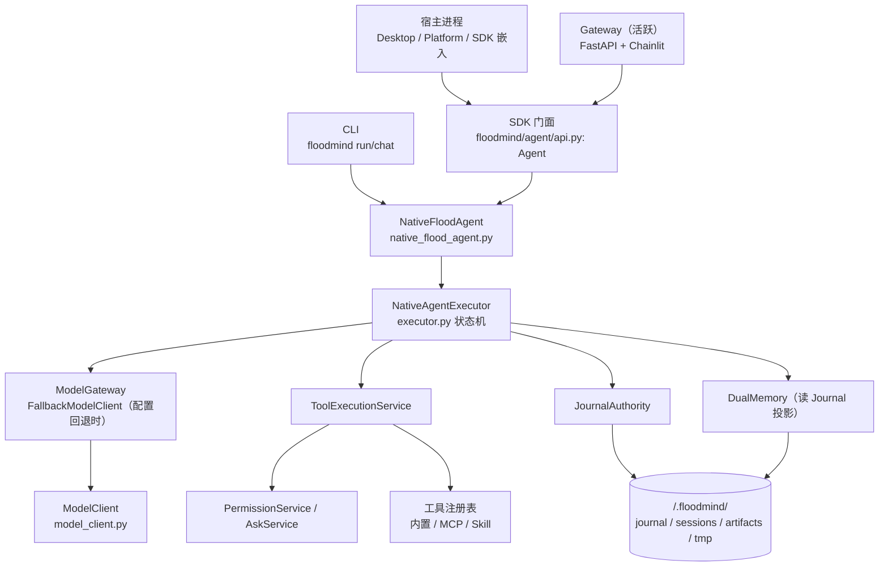
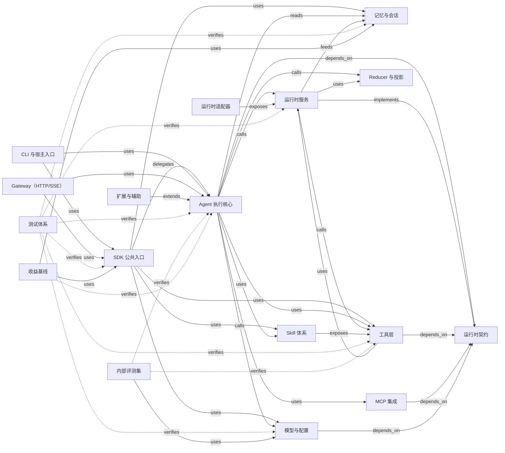
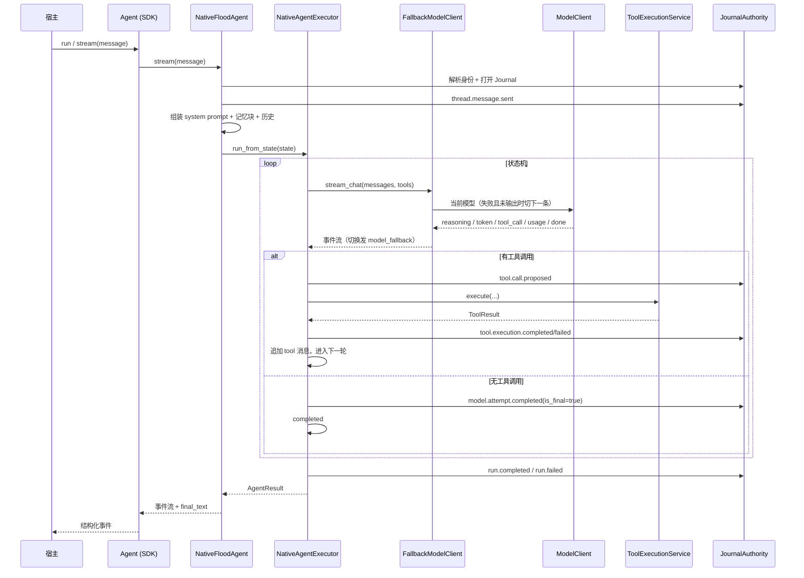

# 01. 系统总览与分层地图

> 基线：`master` 工作区（含 harness 调整与遗留内容清理，HEAD `b21f2e5`），快照 2026-10-19。所有结论以工作区代码为准。

## 1. 系统定位

FloodMind 是一个 **SDK-first 的中文水文预报 AI Agent Runtime**。宿主通过 Python SDK 创建 `Agent`，注入 `ModelClient`、业务工具、Skill/MCP 能力与 `Workspace`，由 Agent 完成“规划 → 调用工具/技能 → 读数据/跑模型/出图/写报告 → 交付产物”。

三条运行边界：

1. **SDK 嵌入**：`from floodmind import Agent`，宿主自己管理进程与 UI。
2. **CLI**：`floodmind run/chat`，单机任务与交互。
3. **网关宿主**：`floodmind/gateway`（FastAPI/SSE + 内置 UI，可选 Chainlit）是**活跃**适配层。旧 `web/`、`floodmind/tui-ts/`、`sdk-ts/`、`floodmind/tui/`、`floodmind/server/` 已全部删除。详见 [08](./08-frontends-and-legacy.md)。

架构决策：默认单代理，不引入多代理框架（[ADR-007](../adr/ADR-007-multi-agent-introduction.md)）；协议面只采用 MCP 工具，不引入 A2A/AG-UI（[ADR-008](../adr/ADR-008-protocol-adoption.md)）。质量闸门由 `tests/` 与 `evals/`（内部评测集，CI 门禁）共同承担；子代理收益由 `benchmarks/multi_agent/` 的对照基线度量。

## 2. 进程与宿主拓扑

关键点：

- `Agent` 只是 `NativeFloodAgent(bare=True)` 的薄封装；完整运行时由 `NativeFloodAgent` 装配。
- `NativeAgentExecutor` 是单次 run 的显式状态机，不感知具体工具。
- 模型调用经 `FallbackModelClient` 门面（`floodmind/agent/native/model_gateway.py`）：只有在本轮尚未输出任何事件时才允许切换，切换后同一 run 内保持，`run_from_state` 开始时复位。
- 工具调用经过权限与事务层，结果写 Journal；记忆从 Journal 投影读取。
- 一个 `Agent` 实例同一时刻只允许一个 run（`_stream_lock`）。

## 3. 分层总表

| 分层 | 文件 | LOC | 符号 | 职责 | 状态 |
|---|---:|---:|---:|---|---|
| `sdk` | 4 | 991 | 42 | 顶层导出、`Agent` 生命周期、SDK 事件投影 | 活跃 |
| `cli` | 5 | 977 | 26 | 命令行与交互式终端 | 活跃 |
| `agent-core` | 23 | 9373 | 372 | 执行状态机、Native 装配、提示词、压缩、流式、模型网关 | 活跃 |
| `runtime-contracts` | 20 | 1389 | 110 | Canonical 事件/状态/工具/权限/检查点等契约 | 活跃 |
| `runtime-kernel` | 2 | 586 | 36 | Reducer 与历史投影 | 活跃 |
| `runtime-services` | 35 | 8787 | 408 | Journal、工具事务、权限、路径、恢复、沙箱、后台、子线程、用量核算、OTLP 导出、计划持久化 | 活跃 |
| `runtime-adapters` | 9 | 319 | 18 | Flask/SSE 适配 | 待确认（无生产调用方） |
| `memory` | 11 | 4604 | 241 | Journal 投影历史、项目级 core memory、任务经验、巩固/回顾、语义存储、会话隔离 | 活跃 |
| `tools` | 6 | 4116 | 164 | 内置工具与 ToolSpec 契约 | 活跃 |
| `skills` | 65 | 13322 | 455 | Skill 注册表/策展器 + 内置技能包 | 活跃 |
| `mcp` | 1 | 677 | 42 | MCP 客户端池与工具发现 | 活跃 |
| `model-config` | 13 | 2767 | 161 | 模型门面、供应商 Codec、网关、配置解析 | 活跃 |
| `extension` | 6 | 363 | 20 | Profile、插件、护栏、移交、上下文块 | 活跃（部分仅完整模式） |
| `agent-services` | 5 | 1092 | 70 | 上下文运行时、Agent 注册、任务/定时运行时 | 活跃 |
| `common` | 2 | 135 | 13 | 文件锁等通用能力 | 活跃 |
| `gateway` | 7 | 1725 | 67 | FastAPI/SSE 网关与内置 UI | 活跃 |
| `evals` | 5 | 4349 | 65 | 内部评测集：冒烟/工具/回归/安全四层 + held-out，驱动真实执行器 | 活跃（CI 门禁） |
| `benchmarks` | 6 | 953 | 45 | single/delegated 多代理收益对照，默认离线 | 活跃 |
| 测试 | 137 | 26021 | 2184 | 回归与验收 | 活跃 |
| 工程脚本 | 14 | 3450 | 66 | 冒烟、端到端、判定器校准、成本报告、知识图谱生成与可视化 | 活跃 |
| 其它 | 4 | 254 | 3 | 未归入以上分层的入口/杂项 | 活跃 |

说明：

- 图只覆盖主项目源码（`floodmind/`、`tests/`、`scripts/`、`skills/`、`evals/`、`benchmarks/`）；`desktop/` 是独立仓库，不进入统计。
- “待确认”由仓库结构、文档声明与实际 import 关系共同判断；详见 [08](./08-frontends-and-legacy.md)。
- `evals` 与 `benchmarks` 是 2026-10 新增层；CI 在 pytest 之后运行 `python -m evals.runner`（`.github/workflows/ci.yml`）。

## 4. 语义子系统图

更细的路径映射见 `graph/subsystems.json`；实际 import 计数见 `graph/metrics.md`。

## 5. 一次用户轮次的主链路

细节见 [03-agent-execution.md](./03-agent-execution.md) 与 [04-runtime-kernel.md](./04-runtime-kernel.md)。

## 6. 核心不变量

1. **Journal 是事实源**：canonical 事件写入 Journal，`RunState` 由 reducer 从事件确定性归约；循环状态是 `RunState` 的投影。
2. **记忆读投影**：`DualMemory` 的用户/助手轮次从 Journal 投影读取，而不是维护独立写路径。
3. **工具事务化**：工具调用先 proposal/事务，再权限校验，再执行；正常结果写 `tool.execution.completed/failed`，`tool.result.committed` 只在恢复/对账路径用于落定僵尸事务。审批有 fingerprint，恢复可重放。
4. **身份四元组**：`conversation_id` / `task_id` / `run_id` / `thread_id` 贯穿事件、Journal、检查和恢复。
5. **失败关闭**：参数非法不执行工具；压缩超预算失败关闭；权限缺失拒绝执行。
6. **单实例单 run**：同一 `Agent` 实例由 `_stream_lock` 保证串行；跨实例的进程级全局绑定是已知风险。
7. **回退不跨输出**：模型回退只允许发生在本轮尚未产生任何流式事件时；一旦输出开始，失败原样上抛，避免同一回答混入两个模型的片段。每次 run 开始时回退状态复位到主模型。

## 7. 结构事实（来自图）

- 连接度最高的文件：`floodmind/agent/native/native_flood_agent.py`（入 21 / 出 52）、`floodmind/agent/runtime/services/journal_authority.py`（入 44 / 出 6）、`floodmind/agent/native/model_client.py`（入 38 / 出 10）、`floodmind/agent/native/types.py`（入 44 / 出 1）、`floodmind/agent/native/executor.py`（入 20 / 出 19）、`floodmind/config/settings.py`（入 28 / 出 3）。
- 契约层被广泛依赖：`permissions.py`（入 29）、`contracts/tools.py`（入 27）、`canonical_events.py`（入 26）、`runtime_context.py`（入 23）。
- 4 个文件级循环：
  1. config 六文件环（`model_client` → `model_resolver`/`provider_registry`/`model_presets`，`settings` ↔ `secret_store`，`provider_registry` → `model_client`）
  2. `skills/base.py` ↔ `skills/registry.py`
  3. `tools/base_tools.py` ↔ `tools/file_tools.py`
  4. `cli.py` ↔ `cli_interactive.py`
- 213 个文件没有入边，其中大量是测试、技能包脚本与入口文件；需要区分“入口/插件脚本”和“疑似死代码”。

这些不是“必须消灭”的指标，而是改动前需要知道的结构约束。处理建议见 [11-risk-register.md](./11-risk-register.md)。

## 8. 与历史文档的差异

`docs/architecture/OVERVIEW.md`（v4.2，2026-08-11）描述的是 SDK-first 目标态。旧宿主栈 `floodmind/server/`、`floodmind/tui/`、`web/`、`floodmind/tui-ts/`、`sdk-ts/` 已全部删除；当前唯一内置宿主适配层是 `floodmind/gateway/`（2026-08-30 之后新增）。`desktop/` 是独立仓库，按 SDK 契约对接。本图谱只覆盖主仓库实际代码，清理记录与剩余边界见 [08](./08-frontends-and-legacy.md)。
