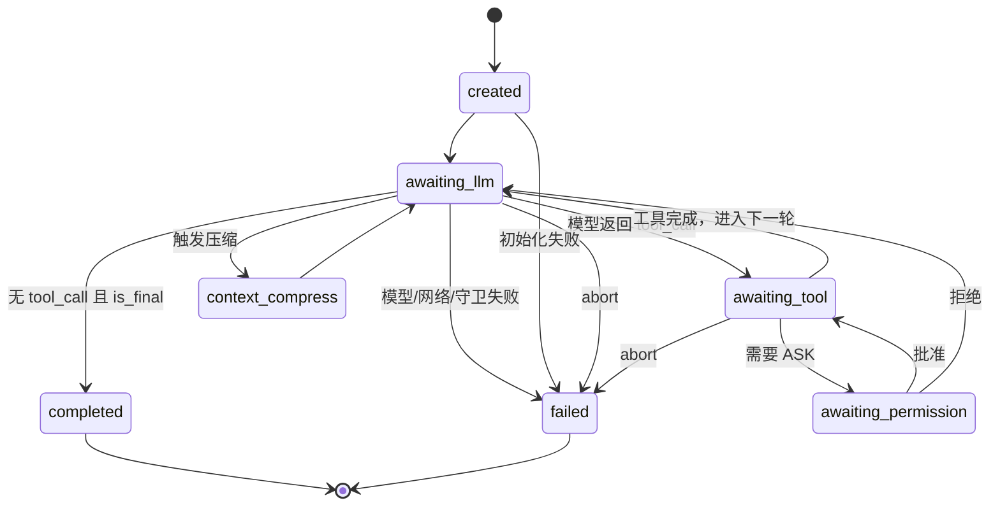

# 03. Agent 执行核心

> 代码位置：`floodmind/agent/native/`。核心文件：`native_flood_agent.py`、`executor.py`、`types.py`、`message_builder.py`、`context_compressor.py`、`response_pipeline.py`。

## 1. 四层职责

```text
Agent (SDK 门面, api.py)
  └─ NativeFloodAgent (装配 + 一轮生命周期 + 提示词 + 流式事件)
       └─ NativeAgentExecutor (显式状态机, 单次 run)
            └─ Services / Journal / Tool / Model
```

| 层 | 负责 | 不负责 |
|---|---|---|
| `Agent` | 参数校验、事件收集、`last_usage`/`artifacts`、resume 门面 | 提示词、状态机 |
| `NativeFloodAgent` | 身份解析、Journal 打开、提示词与记忆块组装、事件总线、后台/子代理装配、WorkSpace 绑定 | 单轮 LLM 循环 |
| `NativeAgentExecutor` | 状态转移、模型调用、工具事务、压缩、检查点、终态 | 宿主适配、UI |
| Services | Journal、权限、工具执行、路径、沙箱、恢复 | 业务工具实现 |

`NativeAgentExecutor` 是唯一驱动 LLM 循环的地方。`NativeFloodAgent` 的 `_stream_lock` 保证同一 Agent 实例串行。

## 2. 状态机

`AgentLoopState.status` 的取值与迁移：



要点：

- 状态机是**显式的**，不是靠异常跳出循环。
- 暂停（pause）通过 abort 实现，最终落到 `failed`，不存在独立的 `paused` 处理器。`RunStatus.paused` 虽然存在，但 reducer 不会因 pause 事件派生它。
- `context_compress` 是独立分支，压缩失败走 fail-closed（`CompactionOverBudgetError`）。
- `awaiting_permission` 的批准路径只处理一次；若同一轮出现第二次 ASK，当前实现会忽略后续 `awaiting_permission`。

## 3. 一次 `stream` 的完整时序

1. `Agent.stream` → `_iter` → `NativeFloodAgent.stream(message, **kwargs)`。
2. 获取 `_stream_lock`；若已占用则拒绝。
3. 创建 daemon worker 线程与 `queue.Queue`，调用方从队列消费事件（同步、非 asyncio）。
4. 绑定 workspace/路径（`bind_workspace` 的变更在这里生效）。
5. `resolve_identity` 生成/复用 `conversation_id`、`task_id`、`run_id`、`thread_id`。
6. `open_journal_authority` 打开当前 run 的 Journal。
7. 发 `thread.message.sent`。
8. 构建 `RuntimeContext` 与 `RunContext`。
9. 组装 system prompt：
   - `STATIC_GLOBAL`：SOUL + 行为指引 + skills/tools 清单；
   - `STATIC_PER_PROJECT`：`AGENTS.md`；
   - `STATIC_PER_SESSION`：时间、目录、OS；
   - 模型信息段；
   - 宿主 `system_prompt`；
   - 记忆块（历史投影、核心记忆、经验）。
10. 从 Journal replay 出 `RunState`，投影为 `AgentLoopState`，调用 `run_from_state`。
11. 执行器循环：`model.attempt` → tool_call → 工具事务 → 结果事件 → 下一轮。
12. 发 `run.completed` 或 `run.failed`，worker 退出，调用方收到 `final_text`。

## 4. 模型调用与流式

- 执行器通过实例上的 `model_client` 调用模型；完整运行时若配置了 `model_routing.fallbacks`，该对象是 `FallbackModelClient`（`floodmind/agent/native/model_gateway.py`），内部按配置顺序持有主模型与回退模型；未配置时保持原始客户端。
- `ModelClient.stream_chat` 产出 provider 流式 part；`ResponsePipeline` 归一化为 `CanonicalPart`（text/reasoning/tool_call/usage/response_end）。
- 回退语义：只有当前模型在本轮**尚未产出任何事件**时抛错才切换下一条；已输出后失败直接上抛。切换成功后同一 run 内粘在该模型；`run_from_state` 开始时调用 `reset_fallbacks()` 回到主模型（`executor.py:463-465`）。切换会发 `model_fallback` 事件（`native_flood_agent.py:1416`）。
- 执行器在每轮模型调用后**批量回放**文本，而不是边生成边推送（内部 `emit_output=False`）。对宿主表现为“一段一段出来”，不是逐 token。
- 重试：执行器使用 `RetryPolicy(max_retries=3, base_delay=2.0, max_delay=30.0)`，并在退避前/等待中检查 `abort_check`（`executor.py:780-880`）。`should_retry` 会拒绝已输出且无 replay safety 的请求，避免重复输出与重复计费。
- 模型层默认超时 90s（`model_client.py:37`、`transport.py:34`），`from_settings` 未暴露该参数，属于硬编码默认值。
- `token_usage` 事件在每轮结束汇总，`Agent.last_usage` 累加。

## 5. 提示词与上下文

| 层 | 来源 | 变化频率 |
|---|---|---|
| 全局静态 | `SOUL`、行为规范、技能/工具清单 | 进程级 |
| 项目静态 | `$FLOODMIND_HOME/AGENTS.md`（全局级）+ `Path.cwd()/AGENTS.md`（项目级） | 项目级（TTL 缓存） |
| 会话静态 | 时间、目录、OS | 每次 stream |
| 模型信息 | 当前模型标签与 key（`_build_model_info`） | 每次 stream |
| 宿主提示 | `Agent(system_prompt=...)` | 构造时 |
| 记忆块 | Journal 投影 + 核心记忆 + 经验 | 每次 stream |

注意：`ContextRuntime.load_project_rules` 读取的是 `Path.cwd() / "AGENTS.md"`，不是 workspace 根目录。宿主从其他目录启动时项目规则可能缺失或取错。

## 6. 上下文压缩

`ContextCompressor` 参数：

| 参数 | 默认 | 含义 |
|---|---:|---|
| `head_keep` | 2 | 保留头部消息数 |
| `tail_keep` | 4 | 保留尾部消息数 |
| `trigger_threshold` | 0.75 | 触发压缩的窗口占比 |

- 中间段以 Atomic Group 为单位删除，避免拆散 tool_call 与 tool_result。
- 压缩后必须生成摘要；若区间计算失败导致中间段被直接丢弃且无摘要，模型会丢失历史语义。
- 触发阈值与硬预算使用不同来源的窗口值，可能提前失败或延迟压缩。
- 压缩事件：`context_compress_start` / `context_compress_done`。

## 7. 并发模型

| 机制 | 实现 |
|---|---|
| 宿主并发 | 同一 `Agent` 实例 `_stream_lock` 串行；不同实例可并行 |
| 执行线程 | 每次 `stream` 一个 daemon worker + `queue.Queue` |
| 事件总线 | `EventBus` + `RLock`，支持订阅者 |
| 心跳 | 15s 一次 `heartbeat` |
| 工具 | 串行执行（一轮内按调用顺序）；`_ToolRunnerPool` 为每调用一线程 + 信号量，并发上限 8、排队 10s、工具超时 300s |
| 子代理 | `ThreadPoolExecutor` 并行，独立 Journal/沙箱/工具运行时；子代理模型可路由到 `model_routing.subagent_model` |
| 后台任务 | 独立进程 + watcher 线程 |
| 模型回退 | 单 run 内粘滞；只在未输出时切换，每个 run 复位 |

没有 asyncio。所有对宿主的 API 都是同步的。

## 8. 记忆接线

执行器不直接写记忆。它只发事件：

- `model.attempt.completed` → 助手文本；
- `tool.execution.completed/failed` → 工具结果；
- `run.completed` → 轮次收尾。

`DualMemory` 在下一轮读取 Journal 投影得到历史。核心记忆不走 `DualMemory`：`CoreMemoryAppend`/`CoreMemoryRead` 只操作项目级 `CoreMemoryStore`（由 `floodmind/memory/services.py:19` 的 `MemoryServices` 装配）；会话级旧辅助函数已删除，不存在第二条 core memory 写路径。这意味着：

- 进程崩溃时，已写入 Journal 的轮次不会丢；
- 未写入 Journal 的流式片段会丢；
- 后台任务通知没有写入 canonical 历史，恢复后不可见。

## 9. 关键风险

| 风险 | 位置/表现 | 影响 |
|---|---|---|
| worker `finally` 引用可能未绑定的 `context` | `native_flood_agent.py:3186` | 初始化早期失败时可能二次异常 |
| 首轮排队消息被标记已消费 | `_inject_queued_user_messages` 首次调用直接把当前用户消息数记为已消费（`executor.py:1298-1305`） | 启动窗口内排队的消息可能不注入 |
| “流式”实为批量回放 | `emit_output=False` 后统一回放（`executor.py:783-810`） | 长回答首字延迟高 |
| 错误事件重复 | 模型 `error` 事件先 emit 再抛（`executor.py:1596-1600`），失败收尾再次 emit（`:835`） | 前端重复提示 |
| 二次 ASK 未单独处理 | 批准路径只执行第一个 pending call；其结果若再次 `awaiting_permission` 会被当作普通工具结果（`executor.py:1465-1535`） | 需要二次确认的工具静默继续或卡住 |
| 权限轮询 | 每 0.5s 忙等（`executor.py:1403`） | CPU 放大 |
| 压缩触发窗口与硬预算不同源 | 触发用 `context_window`（`:735`），硬预算用 `compute_input_budget(caps)`（`:614`） | 压缩时机不稳定 |
| 全局单例绑定 | `set_memory_instance`、`set_ask_service`、`set_session_context`、`set_workspace` | 多 Agent 同进程互相污染 |
| 项目规则取 cwd | `ContextRuntime.load_project_rules` 读 `Path.cwd()/AGENTS.md`（`context_runtime.py:152`） | 从错误目录启动时规则缺失 |
| 模型信息段替换永不命中 | `_build_model_info` 返回“当前模型: ...”，替换分支却匹配 `"## 模型配置"`（`native_flood_agent.py:3128-3138`） | 每次 stream 追加一段模型信息 |
| 后台通知不入 canonical 历史 | 只追加 `state.messages`（`executor.py:1257-1287`） | 恢复后通知不可见 |
| DOOM 判定用字符串前缀 | `"错误" in result.content[:50]`（`executor.py:1169`） | 误判导致提前终止或空转 |
| 事件队列无界 | `queue.Queue()`（`native_flood_agent.py:2928`）；消费端退出会触发取消（`:3336-3342`） | 慢消费者/异常路径下内存增长 |

## 10. 修改影响提示

| 变更 | 必查 |
|---|---|
| 状态枚举/迁移 | `executor.py`、`types.py`、`project_run_state_to_loop_state`、`tests/test_*state*`、`evals/cases/regression-*` |
| 模型调用/回退 | `ModelClient`、`model_gateway.py`、`ResponsePipeline`、`sdk_events`、`tests/test_model_*`、`tests/test_model_routing.py` |
| 提示词层 | `message_builder.py`、`context_runtime.py`、技能/工具清单生成 |
| 压缩 | `context_compressor.py`、`projection.py`、`tests/test_context_compressor*` |
| 工具事务接线 | `executor.py`、`tool_execution_service.py`、Journal 事件类型、`evals/cases/tool-*` |
| 并发 | `_stream_lock`、worker 生命周期、`EventBus`、abort 语义 |
| 执行器对外可观察行为 | `python -m evals.runner`（smoke/tool/regression/safety 四层，243 个常规用例） |
