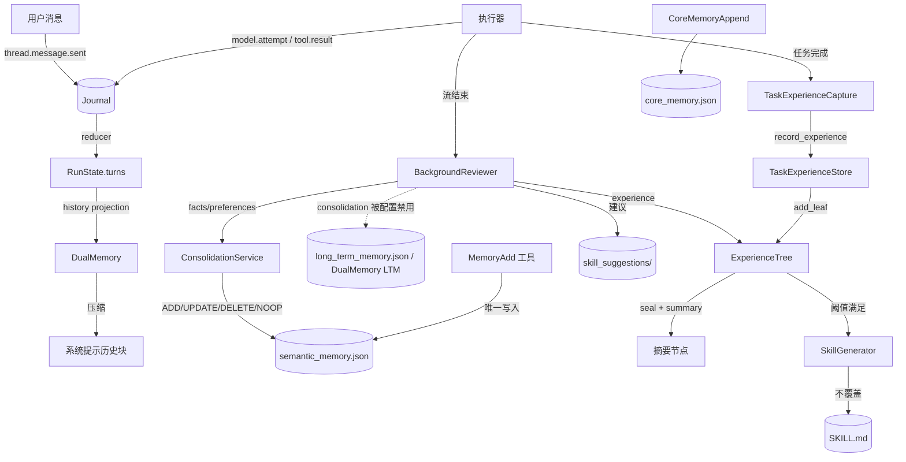

# 05. 记忆与会话

> 代码位置：`floodmind/memory/`、`floodmind/tools/memory_tools.py`、`floodmind/tools/base_tools.py`（MemoryAdd）、`floodmind/agent/native/background_review.py`、`floodmind/memory/session_manager.py`。

## 1. 总原则

**Journal 是对话事实的唯一权威；记忆是派生投影或独立的项目级增强存储。**

- 对话轮次不落独立 JSON，由 reducer 投影成 `RunState.turns`。
- 语义事实、核心记忆、任务经验树是项目级增强存储，不按会话隔离。
- 只有 Journal 目录、旧会话目录、worktree 元数据按会话隔离。
- `MemoryServices`（`services.py:19`）是记忆子系统的唯一装配点；语义存储、召回、固化、核心记忆都从门面取，接线方不再各自构造。

## 2. 记忆分层

| 层 | 内容 | 权威性 | 读写入口 | 注入 |
|---|---|---|---|---|
| 1. Journal 事件 | 用户消息、模型尝试、工具结果、压缩摘要 | 唯一权威，append-only JSONL | `JournalAuthority.emit/replay` | 不直接注入 |
| 2. `RunState.turns` | user/assistant/tool 轮次 | reducer 派生 | `reducer.reduce` | 供投影 |
| 3. 对话历史文本 | 压缩后的历史 | 派生 + 进程内缓存 | `DualMemory.get_chat_history_for_system_prompt` | 系统提示历史块 |
| 4. 语义事实 | 参数、决策、偏好 | 语义层唯一写入权威，`version: 2` | `SemanticMemoryStore`（经 `MemoryServices.store`） | Recall 三因子注入 |
| 5. 旧 LTM | 旧版长期记忆 | 门面启动时一次性导入语义库后冻结只读；仅固化管线被禁用时，回顾路径可回退直写 | `LongTermMemory` | 不再直接注入 |
| 6. 核心记忆 | 项目级关键事实 | 项目级权威 | `CoreMemoryStore`（经 `MemoryServices.core`） | 系统提示核心记忆块 |
| 7. 任务经验树 | 叶子、摘要、热度、技能标记 | 项目级增强存储 | `ExperienceTree` / `TaskExperienceStore` | 经验上下文注入 |
| 8. 技能草案 | 从经验分支生成的 SKILL.md | 派生文件 | `skill_generator` | 技能系统加载 |
| 9. 会话索引/旧消息 | `session.json`、`msg_*.json` | 旧版展示层，非对话权威 | `SessionManager` | 前端分页 |
| 10. 回顾队列 | 技能改进建议 | 待审核数据 | `background_review` | 人工审核 |

## 3. 模块清单

| 文件 | 职责 |
|---|---|
| `services.py` | `MemoryServices` 门面与单例，装配 store/recall/consolidation/core，暴露 `on_turn_completed` / `on_run_completed` / `on_checkpoint` |
| `dual_memory.py` | Journal 投影、历史压缩、旧 LTM（构造参数已收敛为 `session_id/persist_dir/llm/context_window`） |
| `session_manager.py` | 旧会话目录/索引/分页/fork/worktree |
| `core_memory.py` | 项目级核心记忆（默认 `data/memory/core_memory.json`，旧会话文件聚合迁移） |
| `task_experience.py` | 经验捕获、存储、封口、技能生成触发 |
| `experience_tree.py` | 经验树索引、叶子、摘要、去重归档 |
| `consolidation.py` | Mem0 式 ADD/UPDATE/DELETE/NOOP 固化；判定失败全丢弃，不回退直写 |
| `recall.py` | 三因子召回与注入块渲染 |
| `semantic_store.py` | 语义事实存储（`version: 2`），软失效/软删除、`valid_to` 到期清理 |
| `background_review.py`（在 `agent/native/`） | 流结束后的 LLM 回顾 |
| `skill_generator.py` | 经验分支 → SKILL.md 草案 |

## 4. 写入路径

要点：

1. 用户消息以 `thread.message.sent` 事件入 Journal；主 runtime 与 resume 都会发出该事件（`native_flood_agent.py:2877`、`resume_service.py:238-241`）。
2. 助手与工具轮次由执行器事件经 reducer 生成；assistant 条目携带 `tool_calls`。
3. 后台回顾在流结束后启动：门面与 consolidation 都可用时走四类操作；仅当门面不可用或 `memory_consolidation` 被禁用时，才回退旧直写路径（`background_review.py:176-187`）。
4. `MemoryAdd` 只写门面语义存储，重复内容先去重；门面不可用时 fail-closed，**不写旧 LTM**（`base_tools.py:1408-1431`）。该工具已注册进 native orchestrator（`native_flood_agent.py:888`）。
5. 任务经验在任务完成时由 daemon 线程捕获，只有显式传入 `SkillGenerationOwner` 时才生成技能。
6. 经验分支封口后生成摘要，满足条件时生成技能草案（不覆盖已有文件）。
7. `MemoryServices` 构造时一次性把旧 LTM 导入语义库（按 content 去重，`semantic_store.py:258`），并清理已过 `valid_to` 的事实。

## 5. 读取路径

| 入口 | 数据源 | 说明 |
|---|---|---|
| 系统提示历史块 | Journal 投影 turns | 跳过末尾 user，避免与当前输入重复 |
| `MemorySearch` | 对话投影 | **不查语义库**；`search_type` 只是标注 |
| `ConversationSearch` | conversation turns | 返回工具结果 |
| `JournalSearch` | canonical Journal 投影（`tool.execution.*`） | 关键词打分检索；先 `project_current` 物化投影 |
| `JournalGetFullResult` | canonical Journal 投影 | 按 `full_ref` 找回对应工具结果；`full_ref` 由工具输出卸载产生 |
| `CoreMemoryRead` | 项目级 `core_memory.json` | 渲染文本 |
| 核心记忆注入 | 项目级 `core_memory.json` | 字符预算内截断（`ContextPriority 15`） |
| `ExperienceSearch` | 全局经验库单例 | 与 owner 经验库可能不是同一存储 |
| 经验上下文注入 | `TaskExperienceCapture.store` | 带版本缓存与 pending 等待（`ContextPriority 25`） |
| Recall | 语义库 active 条目 | top_k + 时间衰减 + 词面匹配（`ContextPriority 30`） |
| `GlobalSearch` | 旧聊天历史目录 | 无调用方，目录无生产者 |

## 6. 压缩

两层压缩，互不协调：

| 机制 | 阈值 | 作用对象 | 持久化 |
|---|---|---|---|
| DualMemory 历史压缩 | 历史字符占 0.85，保留最近 6 条 | 系统提示中的历史文本 | 仅内存缓存 |
| ContextCompressor | 窗口 0.75，`head_keep=2`，`tail_keep=4`（`context_compressor.py:144-146`） | 发送给模型的 messages | 可写 Journal 压缩事件 |

- DualMemory 压缩缓存键为 `conversation_id + turn_index:role`，不含内容；内容变化但索引不变时可能复用旧结果，只有 `bind_journal` 清空。
- ContextCompressor 只有在 Journal 覆盖充分时才写摘要事件，超预算失败关闭；预算由 `compute_input_budget(capabilities)` 推导。

## 7. 会话隔离

| 标识 | 语义 | 稳定性 |
|---|---|---|
| `session_id` | 外部会话标识 | 调用方提供 |
| `conversation_id` | 对话级稳定标识 | 跨 run 复用 |
| `task_id` | 任务标识 | 每次流新建 |
| `run_id` | 执行标识 | 每次流新建 |
| `thread_id` | 线程标识，子线程投影被排除 | 每次流新建 |
| `turn_id` | 轮次标识 | 每次流新建 |

`SessionManager` 校验规则：最长 128 字符，允许 `[A-Za-z0-9-_.]`，拒绝 `.`、`..`、尾点、Windows 保留名；路径做包含校验。

隔离边界：

- 隔离：Journal 目录、旧会话目录、worktree 元数据。
- 不隔离：语义库、核心记忆、经验树、技能草案，全部项目级共享。

## 8. 持久化与并发

| 文件 | 原子性 | 锁 |
|---|---|---|
| Journal JSONL | FileLock + fsync + 索引 CAS | 跨进程 |
| `semantic_memory.json` | tmp + fsync + replace | 进程内 RLock |
| `core_memory.json` | tmp + fsync + replace | 进程内 RLock |
| `long_term_memory.json` | tmp + fsync + replace；add 路径合并磁盘新增条目 | 进程级 RLock，单进程假设 |
| 经验树 `tree_index.json` | tmp + replace，**无 fsync** | 进程内 RLock |
| 会话索引 / `session.json` | **直接 write_text，非原子** | 无 |
| 技能建议队列 | **直接 write_text** | 无 |

除 Journal 外，所有记忆文件都假设单进程。桌面多实例或 CLI 与桌面同时运行时可能互相覆盖。

## 9. 风险清单

| # | 风险 | 影响 |
|---|---|---|
| 1 | 旧 LTM 与语义库并存 | 导入失败或固化被禁用时，同一事实可能落在不同库 |
| 2 | `ExperienceSearch` 用全局单例，注入/捕获用 owner store | 搜索与写入可能不在同一库 |
| 3 | `MemorySearch` 不查语义库 | 工具描述误导，“长期事实搜索”不可用 |
| 4 | 后台回顾绕过 `record_experience` | 不递增 version，经验上下文不刷新 |
| 5 | 回顾写入不经过 `_should_capture` | 与任务捕获准入规则不一致 |
| 6 | 压缩缓存键不含内容 | 复用陈旧压缩文本 |
| 7 | `fork_session` 语义不完整 | 只复制消息，不注册、不复制 Journal |
| 8 | worktree API 无调用方 | 会话隔离实际不依赖 worktree |
| 9 | 删除会话不清 Journal | 已删除会话仍可被日志工具检索 |
| 10 | 会话根目录假设不一致 | 网关分页与 Journal 投影可能读不同位置 |
| 11 | 经验树维护任务无调用方 | 去重/归档/合并不会自动触发 |
| 12 | 跨 run 的 turn 索引可能重复 | 新用户消息以 `turn_index=0` 写入，多 run 合并后编号不唯一 |
| 13 | 工具结果只在 assistant 条目内截断渲染 | 历史提示看不到完整工具输出 |
| 14 | 经验分词按空白、语义库按二字 | 中文召回行为不一致 |
| 15 | 多个文件非原子写 | 崩溃留下半截 JSON |
| 16 | 记忆文件无跨进程锁 | 多实例覆盖 |

## 10. 修改影响提示

| 变更 | 必查 |
|---|---|
| Journal 事件 schema / reducer | 所有记忆投影、前端历史、压缩、日志工具、Replay |
| DualMemory 压缩 | 阈值 0.85/6、缓存键、系统提示长度 |
| ContextCompressor | `compress_journal` 失败关闭、摘要事件覆盖条件、capabilities 预算 |
| 语义库字段/版本 | `version: 2` 落盘、`import_legacy`、单条容错、固化 target 校验 |
| 核心记忆 | 项目级共享；渲染截断影响所有会话；旧会话迁移只执行一次；会话级辅助函数已删除 |
| 经验存储 | 全局单例与 owner store 两条路径；后台回顾直接 `add_leaf` |
| SessionManager | 校验规则、清理策略、删除不清 Journal 的现状 |
| 工具集 | native agent 的实际工具清单在 `native_flood_agent.py` 的 `all_tools`，不是 `base_tools` 注册函数 |
| 多进程 | 需要为语义库/核心记忆/LTM/经验树补文件锁或迁移到 Journal 式 CAS |

## 11. 回归重点

1. Journal 重放一致性与 turn 索引。
2. 历史压缩缓存与内容变更后的刷新。
3. 回顾写入后的经验上下文版本刷新。
4. 语义库软失效链与固化冲突候选。
5. SessionManager 旧索引对账。
6. `core_memory.json` / `semantic_memory.json` 损坏时的降级路径。
7. `MemoryAdd` / `CoreMemoryAppend` 只走门面存储（无第二写入路径）。
